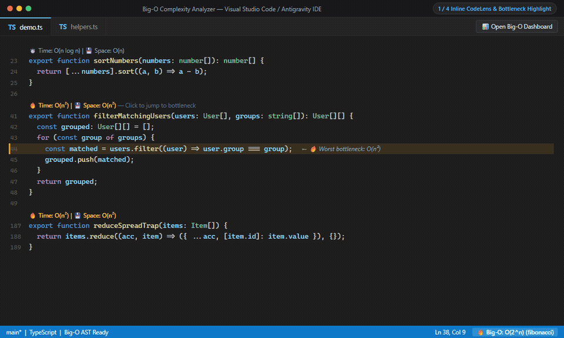
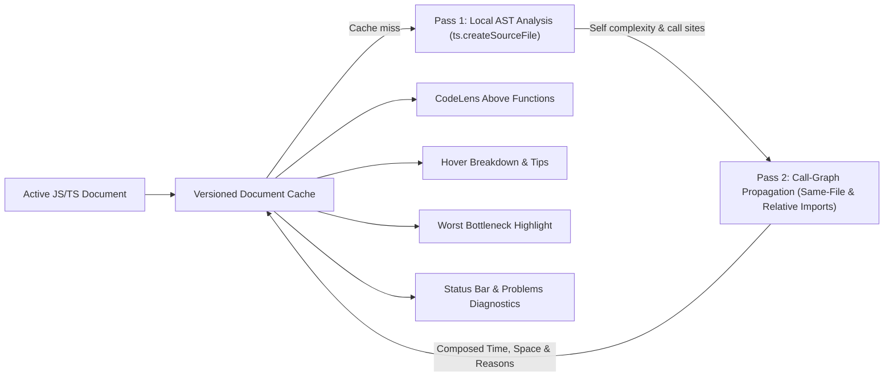
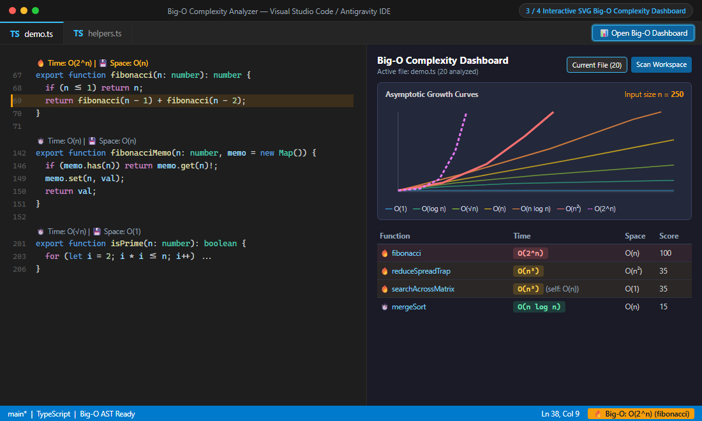

# Big-O Complexity Analyzer

**Offline, zero-config Time & Space Complexity (Big-O) analysis directly inside VS Code for JavaScript and TypeScript.**

Powered by the official TypeScript compiler AST (`ts.createSourceFile`), **Big-O Complexity Analyzer** evaluates your functions as you type—with no API keys, no cloud LLM latency, and no native binary dependencies.



---

## Quick Access Cheat Sheet

| Feature | How to Access |
| :--- | :--- |
| **Interactive Big-O Dashboard** | Click the **`🔥 Big-O: ...`** pill in the **bottom-left** status bar, click **`📊`** in the editor toolbar, click the link inside any **Hover tooltip**, or run `Big-O: Open Complexity Dashboard` |
| **Workspace Hotspot Scan** | Click **`Scan Workspace Hotspots`** inside the Dashboard or run `Big-O: Scan Workspace Hotspots` |
| **Inline CodeLens** | Shown directly above every function, method, and arrow function — click to jump to the bottleneck line |
| **Hover Breakdown & Tips** | Hover over any function header for Total vs. Self complexity, reasons, and refactoring tips |
| **Quick Fixes (`Ctrl+.`)** | Press `Ctrl+.` on any diagnostic to insert `// bigo-ignore` or open the Dashboard |
| **Interactive Walkthrough** | Run `Big-O: Open Getting Started Walkthrough` (or click **Get Started** on the extension page) |

---

## Why This Was Built

Most performance bugs in JavaScript and TypeScript do not come from slow syntax—they come from **accidental asymptotic growth**:

- Calling `.includes()`, `.indexOf()`, or `.filter()` inside a `for` loop (`O(n²)`)
- Spreading accumulators (`{ ...acc }` / `[...acc]`) inside `.reduce()` or loops (`O(n²)`)
- Calling `.shift()`, `.unshift()`, `.splice()`, `JSON.stringify()`, or `Object.keys()` inside loops (`O(n²)`)
- Calling a seemingly harmless `O(n)` helper function inside a loop (`O(n²)`)
- Re-sorting inside an outer loop (`O(n * m log m)`)
- Writing unmemoized branching recursion (`O(2^n)`)

Existing tools are typically either **cloud/AI-based** (requiring API keys, sending code externally, and adding seconds of latency) or **single-function toy analyzers** that miss helper composition. This extension was built to give engineers **instant, deterministic, offline feedback** right above every function header while keeping the analyzer core completely pure and unit-testable.

---

## Installing in VS Code

### From the VS Code Marketplace (once published)
Search the Extensions view (`Ctrl+Shift+X` / `Cmd+Shift+X`) for:
- **Display Name:** `Big-O Complexity Analyzer`
- **Extension ID:** `Ockersz.bigo-complexity-analyzer`

Or install via Quick Open (`Ctrl+P`):
```text
ext install Ockersz.bigo-complexity-analyzer
```

### From a Local `.vsix` File
```bash
npm run package:vsix
code --install-extension bigo-complexity-analyzer-1.2.0.vsix
```

---

## Architecture

The extension separates pure TypeScript AST analysis (`src/analyzer.ts`, zero `vscode` imports) from VS Code UI integration and caches results per document version.



### How Two-Pass Call-Graph Propagation Works
1. **Pass 1 (Local Analysis):** Parses the file with `ts.createSourceFile`, evaluates each function's **self** complexity, and records every call to nested inner helpers, sibling functions, `this.method()` calls, and relative `./` or `../` imports along with the enclosing loop depth.
2. **Pass 2 (Composition with Cycle Guard):** Resolves call targets bottom-up with memoization and a `visiting` cycle guard (handling mutual recursion and circular imports safely). If an `O(n)` helper is called inside a `for` loop, the caller reports **`O(n²)` total** (`O(n)` self) and points directly to the helper call site.

---

## Real-World Scenarios

### 1. Hidden Quadratic Array Lookup → Hash `Set` (`O(n²)` → `O(n)`)
```ts
// 🔥 Time: O(n²) | 💾 Space: O(1)
const hasOverlap = (a: number[], b: number[]) =>
  a.some((item) => b.includes(item));

// ✅ Optimized: ⏱️ Time: O(n) | 💾 Space: O(n)
function hasOverlapFast(a: number[], b: number[]): boolean {
  const seen = new Set(b);
  return a.some((item) => seen.has(item));
}
```

### 2. Unmemoized vs. Memoized Recursion (`O(2^n)` → `O(n)`)
```ts
// 🔥 Time: O(2^n) | 💾 Space: O(n)
function fib(n: number): number {
  return n <= 1 ? n : fib(n - 1) + fib(n - 2);
}

// ✅ Memoized: ⏱️ Time: O(n) | 💾 Space: O(n)
function fibMemo(n: number, memo = new Map<number, number>()): number {
  if (n <= 1) return n;
  if (memo.has(n)) return memo.get(n)!;
  const val = fibMemo(n - 1, memo) + fibMemo(n - 2, memo);
  memo.set(n, val);
  return val;
}
```

### 3. Logarithmic Loops & Composition (`O(log n)` & `O(n log n)`)
```ts
// ⏱️ Time: O(log n) | 💾 Space: O(1)
function binarySearch(sorted: number[], target: number): number {
  let left = 0;
  let right = sorted.length - 1;
  while (left <= right) {
    const mid = (left + right) >> 1;
    if (sorted[mid] === target) return mid;
    if (sorted[mid] < target) left = mid + 1;
    else right = mid - 1;
  }
  return -1;
}
```
Calling `binarySearch()` inside a `for-of` loop over rows composes cleanly to **`O(n log n)`**.

### 4. Sub-Function & Cross-File Propagation
Calling `linearFind(row, target)` imported from `./helpers` inside a `for-of` loop automatically propagates the imported `O(n)` cost to report **`O(n²)` total** (`O(n)` self), and clicking the CodeLens jumps straight to the `linearFind(...)` call line.

### 5. Constant-Bounded Loops & `// bigo-ignore`
- Small fixed-bound loops (`for (let i = 0; i < 3; i++)`) are recognized as **`O(1)`**.
- Add `// bigo-ignore` on or directly above any function header to suppress its CodeLens, decorations, status bar entry, and diagnostics.

---

## Complexity Heuristics

| Construct | Time Estimate | Space Estimate |
| :--- | :--- | :--- |
| Plain expressions / constant-bounded `for` (`<= 1000`) | `O(1)` | `O(1)` |
| Halving / doubling loops (`*= 2`, `/= 2`, `>> 1` midpoint) | `O(log n)` | `O(1)` |
| Square-root bounded loops (`i * i <= n`, `i <= Math.sqrt(n)`) | `O(√n)` | `O(1)` |
| Single loop (`for`, `for-of`, `for-in`, `while`, `do-while`) or `.map`/`.filter`/`.includes` | `O(n)` | `O(1)` (or `O(n)` if allocating) |
| `.sort()` standalone / Divide-and-conquer (`mergeSort`) / `.sort()` in loop | `O(n log n)` / `O(n * m log m)` | `O(1)` / `O(n)` |
| Spread in loop or `.reduce()`, `.shift()`/`.splice()` in loop, `JSON`/`Object.*` in loop | `O(n²)`+ | Scales with allocations |
| Nested loops / nested array methods (depth `k`) | `O(n²)`, `O(n³)`, `O(n^k)` | Scales with nested allocations |
| Linear recursion / Memoized recursion | `O(n)` | `O(n)` call stack |
| Branching recursion (2+ recursive calls without memoization or split) | `O(2^n)` | `O(n)` call stack |

---

## Dashboard, Quick Fixes & Workspace Audit



- **Interactive Big-O Dashboard (`Big-O: Open Complexity Dashboard`):** Click the **`📊` graph icon** in the editor toolbar or click the bottom-right status bar item to view an interactive SVG Big-O growth chart with an input-size `n` slider, worst-first function breakdown, and click-to-jump navigation.
- **Workspace Hotspot Scan (`Big-O: Scan Workspace Hotspots`):** Scans all `.ts`, `.tsx`, `.js`, and `.jsx` files in your workspace and lists every hotspot sorted worst-first.
- **Quick Fixes (`Ctrl+.`):** Directly from any diagnostic, suppress intentional hotspots with `// bigo-ignore` or jump into the Complexity Dashboard.

---

## Settings & Commands

### Settings
| Setting | Type | Default | Description |
| :--- | :--- | :--- | :--- |
| `bigoAnalyzer.enabled` | `boolean` | `true` | Enable or disable inline complexity analysis. |
| `bigoAnalyzer.showCodeLens` | `boolean` | `true` | Display CodeLens complexity summaries above functions. |
| `bigoAnalyzer.showDecorations` | `boolean` | `true` | Highlight the worst bottleneck line in the active editor. |
| `bigoAnalyzer.hotspotThreshold` | `string` | `"O(n²)"` | Minimum complexity flagged as `🔥` (`O(n log n)`, `O(n²)`, `O(2^n)`). |
| `bigoAnalyzer.showDiagnostics` | `boolean` | `true` | Report hotspot functions in the VS Code Problems panel. |
| `bigoAnalyzer.diagnosticSeverity` | `string` | `"Information"` | Diagnostic severity (`Hint`, `Information`, `Warning`). |
| `bigoAnalyzer.preset` | `string` | `"recommended"` | Team rule preset (`relaxed`, `recommended`, `strict`). |
| `bigoAnalyzer.rules` | `object` | `{}` | Per-rule severity overrides (`off`, `hint`, `info`, `warning`). |
| `bigoAnalyzer.ignore` | `string[]` | `[]` | Glob patterns of files to skip from analysis. |

### Commands
- **`Big-O: Jump to Bottleneck`** (`bigoAnalyzer.revealBottleneck`) — Jumps to and selects the worst-case construct inside a function.
- **`Big-O: Toggle Complexity Annotations`** (`bigoAnalyzer.toggleEnabled`) — Toggles the extension on/off globally.
- **`Big-O: Open Complexity Dashboard`** (`bigoAnalyzer.openDashboard`) — Opens the interactive SVG Big-O growth chart and current-file breakdown.
- **`Big-O: Scan Workspace Hotspots`** (`bigoAnalyzer.scanWorkspace`) — Audits all JS/TS files in the workspace and lists hotspots worst-first.
- **`Big-O: Create Team Config (.bigorc.json)`** (`bigoAnalyzer.initConfig`) — Creates and opens a starter `.bigorc.json` in your workspace root.
- **`Big-O: Open Getting Started Walkthrough`** (`bigoAnalyzer.openWalkthrough`) — Opens the built-in 4-step interactive walkthrough inside VS Code / Antigravity IDE.

---

## Team Rule Sets (`.bigorc.json` & Presets)

Commit a `.bigorc.json` file in your repository root (or run **`Big-O: Create Team Config (.bigorc.json)`**) to enforce shared Big-O standards across your team—edits reload automatically on save.

```json
{
  "preset": "recommended",
  "rules": {
    "noSpreadInLoop": "warning",
    "noShiftInLoop": "warning",
    "noHeavyLoopOp": "info",
    "noRegexInLoop": "info",
    "noNestedArrayLookup": "info",
    "noSortInLoop": "info"
  },
  "ignore": ["**/*.test.ts", "scripts/**"]
}
```

| Preset | Default Threshold | Default Severity | Behavior |
| :--- | :--- | :--- | :--- |
| `relaxed` | `O(n²)` | `Hint` | Flags quadratic loops, spreads, `.shift()`, and nested lookups; turns off `.sort()`, `JSON`/`Object.*`, and `RegExp` rules. |
| `recommended` | `O(n²)` | `Information` | Balanced defaults with all 6 anti-pattern rules enabled at `info`. |
| `strict` | `O(n log n)` | `Warning` | Flags `O(n log n)`+ hotspots and elevates all 6 anti-pattern rules to `warning`. |

Supported rule keys: `noSpreadInLoop`, `noShiftInLoop`, `noHeavyLoopOp`, `noRegexInLoop`, `noNestedArrayLookup`, `noSortInLoop` (each accepts `"off"`, `"hint"`, `"info"`, or `"warning"`).

---

## Publishing & Automated Releases (Zero Secrets / OIDC)

This repo includes [ci.yml](.github/workflows/ci.yml) (runs on pushes/PRs to `main`) and [publish.yml](.github/workflows/publish.yml) (automatically tests, packages, creates a GitHub Release, and publishes to both **VS Code Marketplace** and **Open VSX** on any `v*` tag using **Trusted Publishing OIDC**—no stored PAT secrets required).


### Releasing a New Version
```bash
npm version patch && git push --follow-tags
```
Pushing the `v*` tag automatically triggers `publish.yml` to update VS Code Marketplace, Open VSX (Antigravity IDE), and GitHub Releases.

## Local Development

```bash
npm install
npm test              # Run pure AST unit tests (node --test)
npm run compile       # Typecheck and bundle dist/extension.js
npm run package:vsix  # Build production .vsix package
```

Press `F5` in VS Code to launch the Extension Development Host with `sample/demo.ts`.
